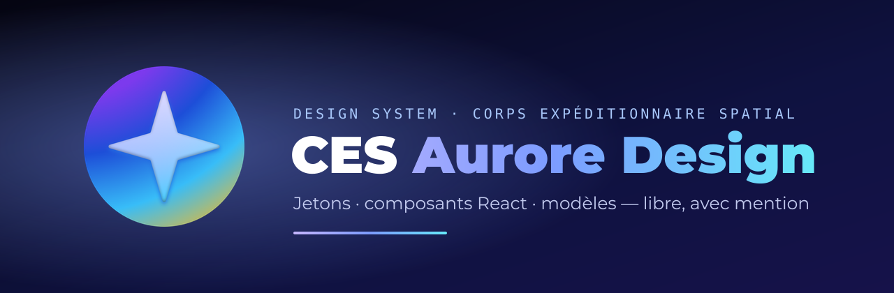

<p align="center"></p>

<p align="center">
  <a href="https://aurore-design.ces-sc.fr"></a>
  <a href="LICENSE"></a>
  
  
  
</p>

<p align="center">
  <b>Le design system du Corps Expéditionnaire Spatial</b>, organisation francophone sur Star Citizen.<br>
  La nuit, le bleu et l’aurore du CES — en jetons, composants React et modèles prêts à l’emploi.
</p>

<p align="center">
  <a href="https://aurore-design.ces-sc.fr"><b>Site</b></a> ·
  <a href="https://aurore-design.ces-sc.fr/design-system"><b>Composants (version déployée)</b></a> ·
  <a href="https://experimental-systems.ces-sc.fr/design-system"><b>Version en test</b></a> ·
  <a href="https://aurore-design.ces-sc.fr/licence/"><b>Licence</b></a>
</p>

---

## ✨ En bref

| | |
|---|---|
| 🎨 **Jetons à trois étages** | primitifs (bleu CES, nuit, aurore) → sémantiques (`--ds-surface-*`, `--ds-text*`, `--ds-primary`…) → composants. Aucune valeur brute dans un composant. |
| 🧩 **94 exemples référencés** | boutons, champs, menus, dialogues, tableaux, calendrier, graphiques, éditeur riche, et des modèles CES (grades, certifications, DEFCON, messagerie…). |
| 🔖 **Identifiants stables** | chaque exemple porte un code `DS-XXX-NN`, jamais renuméroté — on le cite pour désigner ou retoucher un composant. |
| 🌗 **Clair, sombre, système** | chaque jeton est redéfini par mode ; « Système » suit l’OS en direct. |
| ⚡ **Sobre pour le GPU** | animations en `transform` / `opacity`, pas de flou sur les éléments fixes, pause hors écran, « réduire les animations » respecté. |
| ♿ **Accessible** | composants pilotables au clavier, `<dialog>` natif, rôles ARIA, libellés en français. |

## 📦 Contenu

```
src/
├── tokens.css        jetons (primitifs → sémantiques, par mode)
├── ds.css            composants de base (.ds-*)
├── advanced.css      composants avancés et modèles CES
├── components.js     Button, InputText, Select, Dialog, Tabs, DataTable, Toast…
├── advanced.js       Combobox, Drawer, Calendar, graphiques, Kanban, ModuleHero, PortalFooter…
├── editor/           éditeur riche (TipTap)
├── aurore.js         nom et version
├── license.js        texte de la licence et mention
├── theme/            moteur clair / sombre (useColorScheme)
└── assets/           logos du CES (non couverts par la licence)
docs/AURORE-DESIGN.md la référence complète (règles, journal, catalogue)
```

## 🚀 Utiliser

```js
import './src/tokens.css';
import './src/ds.css';
import './src/advanced.css';
import { DsRoot, Button, Tag } from './src/components';

export default function App() {
  return (
    <DsRoot>
      <Button variant="aurora">Rejoindre</Button>
      <Tag value="DS-TAG-01" />
    </DsRoot>
  );
}
// Basé sur CES Aurore Design v1.5
```

- Les styles vivent sous `.ds` : rien ne déborde sur le reste de la page.
- Le mode se lit sur l’attribut `data-mui-color-scheme="light|dark"` de `<html>` (voir `src/theme/colorScheme.js`).
- Dépendances : `react`, `react-dom` et `@remixicon/react` ; `@dnd-kit`, `@fullcalendar` et `@tiptap` seulement pour le Kanban, le calendrier et l’éditeur.
- Polices conseillées : **DM Sans** (texte), **Ubuntu Mono** (étiquettes), **Orbitron** (logotype).

## 🧭 Versions

| Version | Où | Statut |
|---|---|---|
| **v1.5** | ce dépôt · [version en test](https://experimental-systems.ces-sc.fr/design-system) | dernière publiée |
| déployée | [aurore-design.ces-sc.fr](https://aurore-design.ces-sc.fr/design-system) | en service sur le portail du CES |

Le journal détaillé de chaque version est dans [docs/AURORE-DESIGN.md](docs/AURORE-DESIGN.md#journal).

## 📜 Licence

**[Licence CES Aurore Design 1.0](LICENSE)** — utilisation, modification et redistribution **libres**, par une personne comme par une **IA**.
Une seule condition : afficher de façon visible (pied de page, crédits, README ou en-tête de fichier) :

> **Basé sur CES Aurore Design v1.5**

Ne sont pas couverts : le nom et les logos du CES, les marques Star Citizen® / Squadron 42® / RSI®, les captures, les polices (SIL OFL) et les icônes Remix Icon, sous leur licence propre.

---

<p align="center"><br>
<sub>Fait avec soin par le <a href="https://ces-sc.fr">Corps Expéditionnaire Spatial</a>. Ce dépôt est une copie publiée depuis le dépôt du portail du CES : les évolutions passent par le CES.</sub></p>
